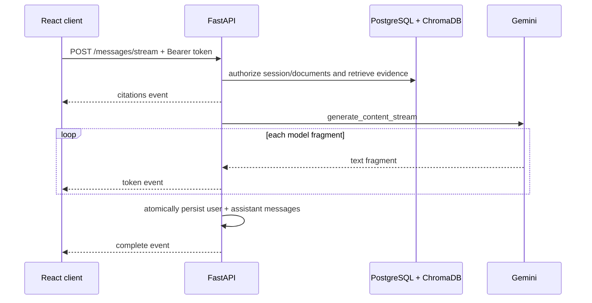

# STEP 11 — Realtime streaming and system testing

## Streaming architecture

AI Chat uses authenticated SSE over `POST`, rather than the browser `EventSource` API. This allows the request JSON and `Authorization: Bearer ...` header to be sent without placing a token in the URL.



The client parses SSE from `fetch().body`, so it can use an `AbortController`. On disconnect/cancellation the response generator is closed and no partial conversation is persisted. Provider and persistence failures are returned as a safe `error` event. Completed streams include citation metadata and persisted message objects.

### Event contract

| Event | Data | Meaning |
| --- | --- | --- |
| `citations` | `{ "citations": [...] }` | Authorized sources selected before generation |
| `token` | `{ "text": "..." }` | Incremental model text fragment |
| `complete` | session, model, user and assistant messages | Persistence completed successfully |
| `error` | `{ "message": "..." }` | Safe terminal streaming error; partial text is not persisted |

## Test matrix

| Area | Coverage |
| --- | --- |
| Authentication | Register/login/refresh, missing or invalid token |
| Documents | PDF upload, empty/corrupt/invalid PDF, size limit, ownership and storage rollback |
| RAG | Chunk/index/search, dedicated temporary Chroma storage, idempotency, deletion, provider failure and ownership |
| Chat | Grounded prompt, injection treated as untrusted text, citations, no evidence, session isolation, SSE completion/error/disconnect and rollback |
| Agent | Tool routing, limits, failures, prompt injection, persistence, cross-user denial and concurrent session isolation |
| Quiz | Structured generation, malformed output, ownership, grading, duplicate submission and provider failure |
| Analytics | Calculations, empty state, date filters, pagination and user isolation |
| Frontend | Authentication state, typed client, SSE parsing/auth header, validation and reusable error/empty states |

Integration tests require a PostgreSQL database different from development whose name contains `test`. RAG integration tests use pytest temporary directories for ChromaDB and document files.

## Commands

```bash
cd backend
source .venv/bin/activate
pytest -m "not integration"

set -a
source <(grep '^TEST_DATABASE_URL=' .env)
set +a
pytest -m integration

python -m compileall -q app
python -m scripts.measure_performance
```

```bash
cd frontend
npm test -- --run
npm run build
```

## Measured local performance

Measured on 2026-10-26 through the running localhost HTTP API, using PostgreSQL in Docker, persistent ChromaDB, the configured local Sentence Transformers embedding model, and `gemini-3.5-flash-lite`. This is a development-machine smoke measurement, not a production load benchmark.

| Measurement | Result |
| --- | ---: |
| Health endpoint p50 (20 requests) | 0.85 ms |
| Health endpoint p95 (20 requests) | 1.54 ms |
| One-page document indexing, cold model path | 17,445.46 ms |
| Semantic retrieval (`top_k=5`) | 83.54 ms |
| Gemini stream time to first token event | 1,203.24 ms |
| Gemini stream total time | 1,406.54 ms |

The benchmark script creates isolated data, measures real requests, then removes its document, vectors, chat session, and account. Results vary with hardware, model cache state, document size, network, Gemini quota and service load. Concurrent throughput and sustained-load percentiles were not measured.

## Remaining limitations

- Cancellation is best-effort: the server closes the SDK stream, but upstream billing already incurred before cancellation cannot be reversed.
- SSE is implemented for document-grounded AI Chat. Agent and quiz endpoints remain request/response because their structured multi-step result must be validated before use.
- Integration tests mock Gemini for determinism; `scripts/measure_performance.py` is the opt-in live Gemini smoke check.
- There is no Playwright/Cypress browser automation yet; system flows are verified at the API integration layer and frontend streaming parser/component layer.
- Refresh tokens remain in `sessionStorage` until the backend supports rotating `HttpOnly` cookies and server-side revocation.
