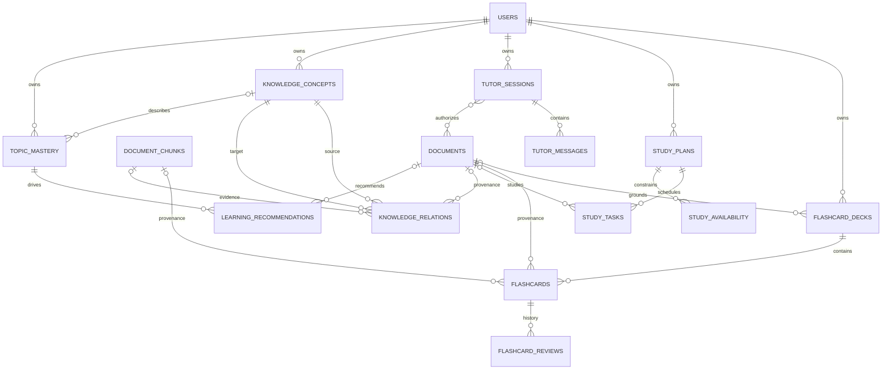

# STEP 13 — Advanced Learning Foundation

## Repository audit

The audit was performed against source code and migrations, not against the
earlier implementation plan.

Implemented and routed modules:

- JWT access/refresh authentication and student/admin roles.
- PDF upload, extraction, ownership isolation, storage, and deletion.
- RAG indexing/search with PostgreSQL chunk metadata and persistent ChromaDB.
- Gemini text, streaming, and Pydantic structured generation.
- Chat sessions, citations, SSE streaming, and LangGraph study agent.
- AI quiz generation, attempts, deterministic grading, and analytics.
- React frontend, Docker deployment, and system smoke test.

Not implemented before STEP 13:

- Flashcard, study planner, tutor, knowledge graph, and topic-mastery tables.
- API routes, repositories, schemas, services, or frontend screens for those
  five modules.
- A durable background worker/broker. STEP 13 defines the boundary only; a
  later feature step must select and deploy the worker technology.

No new Python dependency is required for this foundation. The current broad
dependency ranges should be locked before a production release because a clean
build can otherwise resolve newer minor versions than those previously tested.

## Shared architecture

- `LLMProvider.generate_structured` remains the single provider-independent AI
  structured-output boundary. No second Gemini client was added.
- `provider_compatible_json_schema` centralizes Gemini schema conversion;
  Pydantic remains the authoritative response validator.
- `RAGService` and the existing Chroma collection remain the only document
  retrieval/indexing path.
- `DocumentOwnershipService` validates a complete document set by authenticated
  `user_id` and returns a non-enumerating error for missing/non-owned IDs.
- `LearningTopicIdentifier` accepts only evidence that has already passed RAG
  authorization and rejects citations outside the supplied chunk IDs.
- `AIJobDispatcher` is the interface for a later durable queue. No in-process
  fire-and-forget task runner was introduced because it would lose jobs on
  restart and complicate cancellation.
- `AIObservability` records operation, model, user ID, counts, latency, and error
  type without prompts, document text, tokens, or API keys.
- Gemini concurrent calls are bounded by `GEMINI_MAX_CONCURRENT_REQUESTS` in
  addition to existing timeout and retry controls.

## ER design



Ownership is stored only at aggregate roots. A flashcard inherits ownership
from its deck, a task from its plan, a tutor message from its session, and a
recommendation from its mastery record. Document/chunk foreign keys are stored
only where provenance or a learning target must survive independently.

### Scheduling and evidence

- Every flashcard review is immutable history with rating, interval, ease,
  repetition count, review time, and next-review time. No review row is updated
  into the next state.
- Study tasks store status, planned start/due time, positive duration, and
  completion time. Database checks prevent a completion timestamp on a task
  that is not completed.
- Knowledge relation confidence and topic mastery scores are constrained to
  `[0, 1]`. Mastery stores evidence count and last evidence time so an empty or
  stale estimate can be distinguished from measured performance.

## Security boundary for later modules

1. Derive `user_id` only from validated JWT dependencies.
2. Resolve every aggregate by both resource ID and authenticated user ID.
3. Authorize every requested document before retrieval or AI generation.
4. Treat retrieved PDF text as untrusted evidence, never as system instruction.
5. Validate structured output locally and verify all returned provenance IDs.
6. Never put API keys, bearer tokens, prompts, or document content in telemetry.
7. Run long AI work through a durable queue implementation with retry,
   idempotency, timeout, and cancellation semantics before enabling background
   generation endpoints.

## Migration

Migration `20261031_0006` adds only new enums, tables, indexes, constraints, and
foreign keys. It follows `20261026_0005`; no previously applied migration was
edited and no existing table is rewritten. Existing users, documents, chats,
quizzes, attempts, and answers remain untouched.

Before applying to a non-test database:

```bash
cd backend
alembic current
alembic upgrade 20261031_0006 --sql > /tmp/ai-studymate-step13.sql
alembic upgrade head
alembic check
```

Take a database backup first. The integration migration test is destructive and
must only use `TEST_DATABASE_URL`, whose database name contains `test` and is
different from `DATABASE_URL`.

## Deliberately deferred

- No new API endpoint or frontend page.
- No flashcard scheduling algorithm or review service.
- No study-plan generation/optimization.
- No tutor workflow or new LangGraph graph.
- No graph extraction job or graph traversal API.
- No mastery formula, quiz evidence pipeline, or recommendation generation.
- No broker choice, worker deployment, or job persistence schema.

These decisions belong to their respective feature steps and require explicit
product rules and evaluation criteria.
