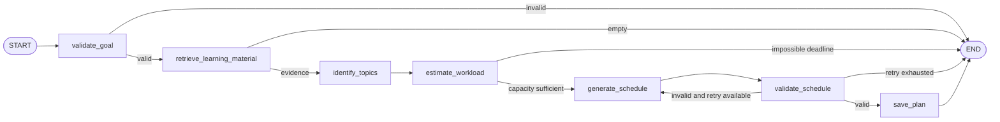

# STEP 15 — AI Study Planner with LangGraph

## Graph



The state contains trusted user identity, authorized document IDs, goal,
availability, timezone, evidence, topics, workload, proposed tasks, retry count,
step count, status, and error. `PLANNER_MAX_STEPS` controls LangGraph recursion;
AI calls and the graph are bounded by `PLANNER_TIMEOUT_SECONDS`.

Gemini identifies grounded topics and evidence. Python alone allocates and
validates dates, duration, capacity, overlap, weekdays, review sessions, and the
exam deadline. PDF text is passed as untrusted evidence.

## API

- `POST /api/v1/study-plans/generate`
- `GET /api/v1/study-plans`
- `GET /api/v1/study-plans/{plan_id}`
- `PATCH /api/v1/study-plans/{plan_id}`
- `DELETE /api/v1/study-plans/{plan_id}`
- `GET /api/v1/study-plans/{plan_id}/tasks`
- `PATCH /api/v1/study-tasks/{task_id}`
- `POST /api/v1/study-plans/{plan_id}/replan`

Generation request:

```json
{
  "goal": "Hoàn thành kiến thức Python căn bản",
  "subject": "Python",
  "exam_date": "2026-12-15",
  "available_days": [0, 2, 4, 6],
  "daily_available_minutes": 90,
  "preferred_session_minutes": 30,
  "difficulty": "medium",
  "document_ids": ["UUID"],
  "timezone": "Asia/Ho_Chi_Minh"
}
```

Days use ISO weekday indexes: Monday `0` through Sunday `6`.

Task updates support `pending`, `in_progress`, `completed`, `skipped`, and
`postponed`. Completion stores actual minutes and UTC completion time. A
postponed task requires a new timezone-aware `planned_start_at`; the server
rejects unavailable days, overlap, and dates after the exam.

Replanning deletes/replaces only non-completed tasks. Completed task IDs,
timestamps, and actual study time remain unchanged.

## Deterministic scheduling rules

- No task may end after the exam date in the configured timezone.
- Only selected weekdays are used.
- Daily total never exceeds `daily_available_minutes`.
- Sessions use the preferred duration and never overlap.
- Difficulty controls topic workload: easy 1, medium 2, hard 3 study sessions.
- Every topic receives an additional review session.
- Capacity is checked before allocation; impossible plans return HTTP `409`.
- The current baseline starts daily sessions at 18:00 local time.

## Database

Migration `20261031_0008` adds planner configuration to `study_plans`, progress
fields to `study_tasks`, the `postponed` enum value, and the many-to-many
`study_plan_documents` table. Existing completed study history is preserved.

## Frontend

- `/study-plans`: goal form, document selection, availability and plan list.
- `/study-plans/{id}`: weekly/daily task calendar, checklist, progress,
  planned-versus-actual minutes, skip and replan actions.

## Limitations

- The deterministic baseline uses a fixed 18:00 local start because the input
  contract provides days and minutes but not preferred clock-time windows.
- Workload estimation is topic/session based, not calibrated from historical
  reading speed.
- Replanning calls Gemini again; provider quota and availability apply.
- No drag-and-drop calendar or notification service is included.
