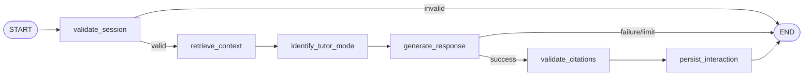

# STEP 16 — Personalized AI Tutor

## Workflow



JWT ownership is validated before graph execution. Mode and difficulty are schema-validated and
cannot be overridden by the model. Chroma retrieval uses the existing per-user filter. PDF text is
untrusted prompt data, and persisted citations must match real retrieval results.

## Modes

- `explain`: explanation with an appropriate example.
- `socratic`: one focused guiding question at a time.
- `practice`: a short exercise.
- `hint`: progressive guidance without immediately disclosing the answer.
- `review`: references only real completed quiz and flashcard-review aggregates.

No mastery claim is made without supporting activity.

## API

- `POST /api/v1/tutor/sessions`
- `GET /api/v1/tutor/sessions`
- `GET /api/v1/tutor/sessions/{session_id}`
- `PATCH /api/v1/tutor/sessions/{session_id}`
- `DELETE /api/v1/tutor/sessions/{session_id}`
- `POST /api/v1/tutor/sessions/{session_id}/messages`

```json
{
  "message": "Giải thích vòng lặp for",
  "mode": "socratic",
  "difficulty": "beginner",
  "document_ids": ["00000000-0000-0000-0000-000000000000"]
}
```

## Configuration and limitations

Execution is bounded by `TUTOR_MAX_STEPS`, `TUTOR_TIMEOUT_SECONDS`,
`TUTOR_HISTORY_MESSAGES`, `TUTOR_HISTORY_MAX_CHARS`, `TUTOR_CONTEXT_TOP_K`, and
`TUTOR_CONTEXT_MAX_CHARS`. The shared Gemini provider supplies concurrency, retries and quota error
handling. STEP 16 uses request/response rather than streaming. Progressive hints are conversation
driven. Quality depends on PDF extraction, indexing, retrieval and the configured Gemini quota.
