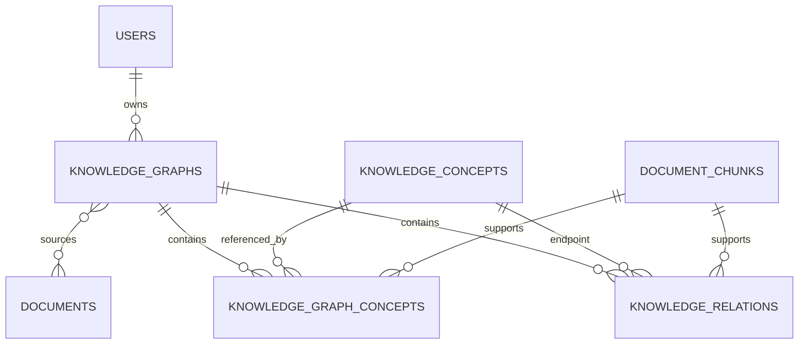

# STEP 17 — Knowledge Graphs

## Storage design

PostgreSQL remains the graph store. `knowledge_graphs` owns a generated graph,
`knowledge_graph_documents` records its authorized inputs, `knowledge_concepts` stores normalized
per-user concepts, `knowledge_graph_concepts` stores definition/page/chunk provenance, and
`knowledge_relations` stores typed directed edges and their source chunk. No Neo4j service is used.



## Extraction controls

The backend validates JWT ownership and index compatibility, reconstructs the authoritative indexed
chunks, and sends bounded batches to Gemini structured output. Python normalizes Unicode names,
deduplicates nodes and edges, verifies relation enums/endpoints/chunk IDs, removes self/dangling
edges, and commits the graph transaction only after all batches pass. PDF text is untrusted data.

Supported edges are `prerequisite_of`, `part_of`, `related_to`, `example_of`, and
`contrasts_with`. Confidence is displayed as an uncalibrated model score, never as probability.
Different extracted definitions are preserved in provenance and marked ambiguous for review.

## API

- `POST /api/v1/knowledge-graphs/generate`
- `GET /api/v1/knowledge-graphs`
- `GET /api/v1/knowledge-graphs/{graph_id}`
- `GET /api/v1/knowledge-graphs/{graph_id}/nodes`
- `GET /api/v1/knowledge-graphs/{graph_id}/edges`
- `GET /api/v1/knowledge-graphs/{graph_id}/concepts/{concept_id}`
- `DELETE /api/v1/knowledge-graphs/{graph_id}`

```json
{"title":"Python foundations","document_ids":["DOCUMENT_UUID"]}
```

## Configuration and limitations

Use `KNOWLEDGE_GRAPH_BATCH_SIZE`, `KNOWLEDGE_GRAPH_MAX_CHUNKS`,
`KNOWLEDGE_GRAPH_MAX_OUTPUT_TOKENS`, `KNOWLEDGE_GRAPH_TIMEOUT_SECONDS`, and
`KNOWLEDGE_GRAPH_VALIDATION_RETRIES`. Extraction is not guaranteed factually correct: users must
inspect linked document pages. Equivalent concepts are deduplicated deterministically by normalized
name, not by an unbounded second semantic-model pass. Documents above the configured chunk cap are
rejected explicitly rather than partially indexed.
