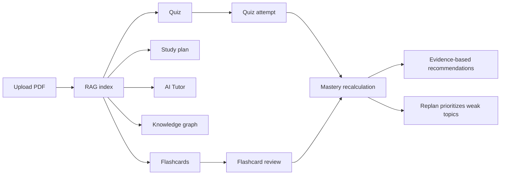
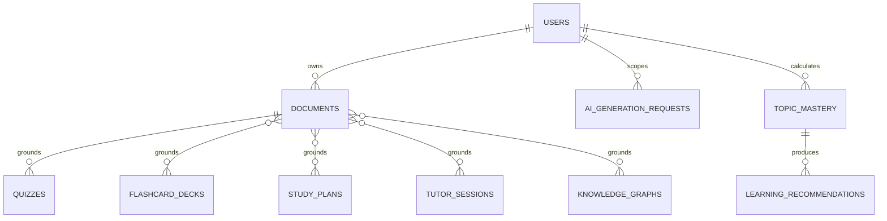

# STEP 19 — Advanced Learning Integration & Evaluation

## Integrated workflow



All ownership decisions derive from the JWT user. AI is mocked only in automated E2E tests; database,
PDF extraction, authentication, response schemas, scheduling, grading, mastery and foreign keys remain
real.



## Reliability changes

Generation endpoints for flashcards, quizzes, study plans and knowledge graphs accept an optional
`Idempotency-Key` header. `ai_generation_requests` stores a user-scoped operation/key, canonical
request hash, status and generated resource ID. A completed replay returns the same resource; key reuse
with another payload or concurrent in-progress generation returns `409`; a failed AI call marks the
record retryable.

Document deletion now checks dependent quizzes, flashcards/decks, study tasks/plans, Tutor sessions and
knowledge graphs before staging a file. It returns `409` with dependency types rather than exposing a
database `500` or leaving derived resources without provenance.

Study Planner reads deterministic `topic_mastery`: newly generated tasks matching `needs_review`
topics receive priority `1` and an evidence-based description. Completed task history remains intact
during replan.

## Evaluation dataset and method

The versioned fixture at `backend/evaluation/advanced_learning_dataset.json` contains one two-page
Python document, two retrieval questions, two citation checks, two flashcards, one Tutor case, one
schedule, one graph case, two quiz examples and one weakness case. Run:

```bash
cd backend
python evaluation/evaluate.py
```

Metrics are exact fixture checks: expected-page hit rate, citation subset correctness, normalized
flashcard answer plus page match, Tutor claim containment in evidence, deterministic schedule
constraints, relation-set F1, quiz answer match and mastery-formula tolerance. They are contract
evaluation results, not a statistically meaningful Gemini benchmark. No score is inserted manually
into documentation; the report is emitted by the runner.

## E2E and defense demonstration

1. Register and log in; show that protected APIs reject anonymous requests.
2. Upload the sample PDF and index it; repeat indexing to demonstrate idempotency.
3. Generate flashcards with an `Idempotency-Key`, replay it, and show the same deck ID.
4. Generate a study plan and inspect time/deadline constraints.
5. Open Tutor in Socratic mode and inspect page citations.
6. Generate and explore the Knowledge Graph; filter an edge type and open its source page.
7. Generate a quiz, answer one question incorrectly and submit once.
8. Review a flashcard as `Again`.
9. Recalculate mastery; explain source-normalized weights and evidence counts.
10. Replan and show a weak-topic task at priority `1`; attempt PDF deletion and explain the safe `409`.

## Known limits

The dataset is deliberately small and cannot establish real-world pedagogical quality. Live Gemini
quality and quota behavior require a separate controlled run and human review. Idempotency is opt-in
for clients through a header. Document deletion is conservative: users must remove dependent learning
resources first. Topic matching uses normalized labels, so corrected taxonomy remains important.
